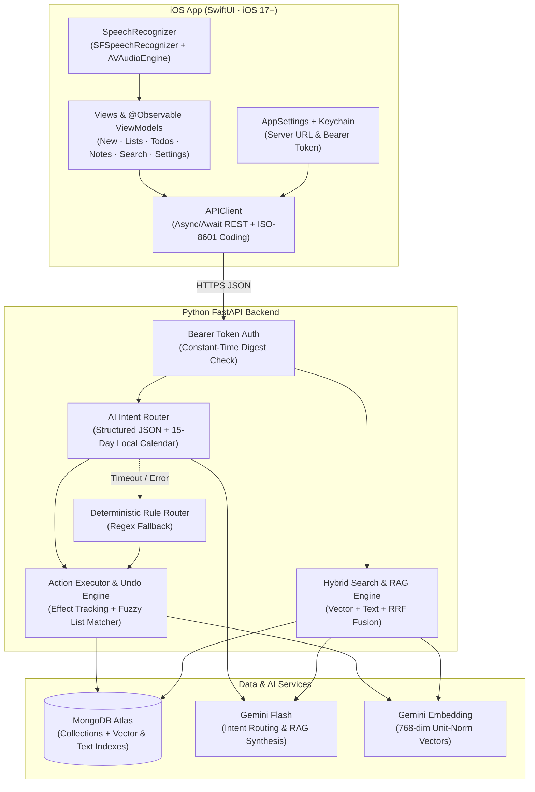
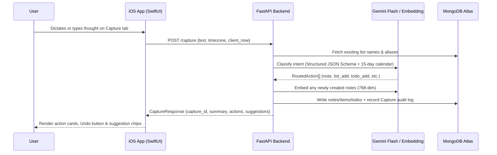

# Spaces

**Spaces** is an AI-powered, voice- and text-first thought journal for iOS designed to eliminate the friction of manual organization. Instead of choosing which folder, list, or task manager an idea belongs to, you type or speak naturally into a single capture bar and Spaces automatically routes your thoughts to the right place.

---

## What It Does

### 1. Natural-Language Multi-Intent Capture
Type or hold-to-talk using on-device speech recognition (`SFSpeechRecognizer` + `AVAudioEngine`). A single sentence can trigger multiple structured actions across domains:
- **Notes & Ideas** (`note`): Reflective thoughts, brainstorms, and notes are automatically titled, tagged, saved, and embedded into a 768-dimensional vector space (*"Idea: a pegboard wall in the garage so bikes hang vertically"*).
- **Smart Lists** (`list_add` / `list_item_remove`): Items are routed to shopping, wish, or custom lists (*"Add eggs and paper towels to my Costco list"*, *"Put AirPods Max on my wish list"*). Mentioning a list that doesn't exist yet automatically creates it, while fuzzy matching maps informal names (*"my costco list"* → `Costco`) and prevents duplicate open items.
- **Dated Todos** (`todo_add` / `todo_complete`): Action items are scheduled onto specific dates resolved relative to your local timezone (*"Tomorrow I need to call the dentist"*, *"Check off call dentist"*).
- **Compound Utterances**: One input can partition into multiple actions at once (*"Add oat milk to Costco, tomorrow call the dentist, and idea about a solar bike charger"* → 1 list item + 1 dated todo + 1 note).

### 2. Full Transactional Undo & Low-Confidence Suggestions
- **One-Tap Undo**: Every capture records a granular audit trail of database side-effects (`captures.effects`). Tapping **Undo** reverses every action from that capture—deleting created notes/items, un-completing modified todos, restoring removed list items, and cleaning up auto-created empty lists.
- **Smart Suggestion Chips**: When an input is ambiguous (confidence $< 0.55$, e.g., *"milk"*), Spaces safely preserves it as a note and surfaces interactive *"Did you mean: Add 'milk' to Costco?"* chips that convert the note into list items with one tap.
- **Zero-Data-Loss Fallback**: If the AI service is unreachable or times out, a deterministic regex rule-router (`rule_route`) parses obvious list/todo patterns, and falls back to saving the raw text as a note so no thought is ever lost.

### 3. Hybrid Concept + Keyword Search & RAG Q&A ("Ask")
- **Concept Search (Semantic)**: Powered by 768-dim Gemini embeddings, finding notes by meaning even when no keywords overlap (*"storing bicycles"* finds *"pegboard wall in the garage"*).
- **Phrase & Keyword Search**: Uses MongoDB Atlas Search with typo-tolerant fuzzy matching across titles, body text, and tags.
- **Reciprocal Rank Fusion (RRF)**: Combines semantic vector rankings and lexical keyword rankings (`0.65` semantic / `0.35` keyword weighting) so both conceptual queries and exact phrases surface at the top. Includes an automatic in-process cosine + BM25-lite fallback engine when running offline or while Atlas indexes build.
- **Ask Mode (RAG)**: Ask natural-language questions over your journal (*"What ideas have I had about the garage?"*). Spaces retrieves the top relevant notes and synthesizes a grounded answer with numbered citations (`[1]`, `[2]`) that deep-link directly to the source notes.

### 4. Dedicated Spaces, Lists, Todos & Notes Management
- **Spaces / Lists View**: Unified workspace with a `Today | Tomorrow | Lists` view, inline checklists with progress bars, item quantities, swipe-to-delete, and one-tap completed item cleanup.
- **Daily Todos & Overdue Tracking**: Segmented day views (`Today`, `Tomorrow`, or calendar date picker) plus an automatic **Overdue** section with one-swipe rescheduling to today.
- **Notes Browser & Editor**: Tag-filtered note cards with relative timestamps and full inline editing of titles, body text, and tags (automatically re-embedding notes when content changes).
- **Warm Dark Humanist UI**: Custom iOS 17+ SwiftUI interface featuring deep obsidian/sand surfaces, editorial serif typography, organic animated checkboxes, and a floating glass navigation dock.

---

## Architecture



### Capture Lifecycle


---

## Tech Stack & Component Breakdown

| Layer | Technology | Role |
|---|---|---|
| **iOS Client** | Swift 5.10, SwiftUI (iOS 17+ `@Observable`), Zero external dependencies | Native client with floating dock navigation, live speech transcription, and Keychain auth |
| **Speech Engine** | `Speech` (`SFSpeechRecognizer`) + `AVFoundation` (`AVAudioEngine`) | Real-time, on-device voice-to-text streaming into the capture buffer |
| **Backend API** | Python, FastAPI, Uvicorn, Pydantic v2 | Async REST service handling capture routing, hybrid search, RAG Q&A, and CRUD |
| **AI & Embeddings** | `google-genai` SDK (`gemini-2.5-flash`, `gemini-embedding-001` / `gemini-embedding-2`) | Schema-constrained JSON intent classification, RAG answer generation, and 768-dim embeddings |
| **Database & Search** | MongoDB Atlas + PyMongo `AsyncMongoClient` | Document storage plus native `$vectorSearch` (`notes_vector`) and `$search` (`notes_text`) |

### Data Model (MongoDB Collections)
- **`notes`**: `{_id, text, title, tags[], embedding[768], capture_id, created_at, updated_at}` — Indexed by `notes_vector` (768-dim cosine similarity) and `notes_text` (Lucene text index on `title`, `text`, `tags`).
- **`lists`**: `{_id, name, slug, kind: "shopping" | "wishlist" | "custom", aliases[], created_at}` — Pre-seeded with *Costco*, *Walmart*, and *Wish List*; auto-extended when new list names are spoken.
- **`list_items`**: `{_id, list_id, text, quantity?, done, capture_id, created_at}` — Individual entries within a list, deduplicated by case-insensitive matching.
- **`todos`**: `{_id, text, due_date: "YYYY-MM-DD", done, done_at?, capture_id, created_at}` — Date-scheduled tasks queried by exact date or overdue range (`due_date < today`).
- **`captures`**: `{_id, raw_text, summary, actions[], suggestions[], effects{}, undone, created_at}` — Full audit record of every capture request and the exact entity IDs created or mutated, powering transactional undo.

### Repository Structure
```text
Spaces/
├── backend/
│   ├── app/
│   │   ├── ai/
│   │   │   ├── gemini.py      # Gemini client wrapper (structured JSON + 768-dim embeddings)
│   │   │   ├── router.py      # Prompt builder, 15-day timezone calendar, LLM & regex fallback router
│   │   │   └── schemas.py     # Pydantic schemas for RoutedAction, RouterResult, AskAnswer
│   │   ├── routes/
│   │   │   ├── capture.py     # /capture, /undo, /suggestions/accept, /search, /ask
│   │   │   └── crud.py        # REST CRUD for /notes, /lists, /lists/{id}/items, /todos
│   │   ├── auth.py            # Bearer token verification
│   │   ├── config.py          # Environment configuration & RRF / confidence thresholds
│   │   ├── db.py              # AsyncMongoClient lifecycle, collection helpers & Atlas index bootstrap
│   │   ├── executor.py        # Action dispatcher, suggestion builder & transactional undo engine
│   │   ├── main.py            # FastAPI application entrypoint & health probe
│   │   ├── search.py          # Hybrid search ($vectorSearch + $search + RRF + in-process fallback) & Ask RAG
│   │   └── services.py        # Fuzzy list matching, note creation & embedding helpers
│   └── tests/                 # Offline unit/integration suite + live Gemini golden-set benchmark
├── ios/
│   ├── Spaces/
│   │   ├── App/               # SpacesApp root & floating glass navigation dock
│   │   ├── Features/          # Capture, Lists, Todos, Notes, and Profile screens + ViewModels
│   │   ├── Networking/        # APIClient, Codable Models & ISO-8601 JSONCoding
│   │   ├── Shared/            # Warm Dark Humanist Theme, custom components & organic checkboxes
│   │   ├── Speech/            # On-device live SpeechRecognizer
│   │   └── Storage/           # Keychain wrapper & observable AppSettings
│   └── SpacesTests/           # Model decoding & mock URLProtocol networking unit tests
└── docs/
    └── API.md                 # Full REST API contract & JSON schemas
```

---

## Quickstart

### Prerequisites
- **Python 3.11+**
- **Xcode 16+** (iOS 17+ Simulator or physical device)
- **MongoDB Atlas** cluster (an M0 free tier cluster works out of the box)
- **Google Gemini API Key** ([Google AI Studio](https://aistudio.google.com/apikey))

### 1. Backend Setup
```bash
cd backend
make install
cp .env.example .env
```

Fill in `backend/.env` with your credentials:
- `MONGODB_URI`: Your MongoDB Atlas connection string
- `GEMINI_API_KEY`: Your Gemini API key
- `API_TOKEN`: A shared secret token (generate one with `python3 -c "import secrets; print(secrets.token_urlsafe(32))"`)

Start the development server (automatically bootstraps collection and Atlas Search / Vector Search indexes on startup):
```bash
make dev
# Server runs at http://localhost:8000 (interactive OpenAPI docs at http://localhost:8000/docs)
```

### 2. iOS App Setup
1. Open the Xcode project:
   ```bash
   open ios/Spaces.xcodeproj
   ```
   *(Optional: if you modify `ios/project.yml`, regenerate the project with `cd ios && xcodegen generate`.)*
2. Select an iOS Simulator (or your physical iPhone) and press **Run (`⌘R`)**.
3. On first launch, the app navigates to the **Profile** tab where you can sign up or log in with your email/username and password.

### 3. Running Tests
```bash
# Run offline backend unit & integration tests (uses in-memory mock DB + deterministic embeddings)
cd backend && make test

# Run live Gemini router golden-set benchmark (requires GEMINI_API_KEY in .env)
cd backend && make test-live

# Run iOS unit tests
xcodebuild -project ios/Spaces.xcodeproj -scheme Spaces \
  -destination 'platform=iOS Simulator,name=iPhone 16' test
```

