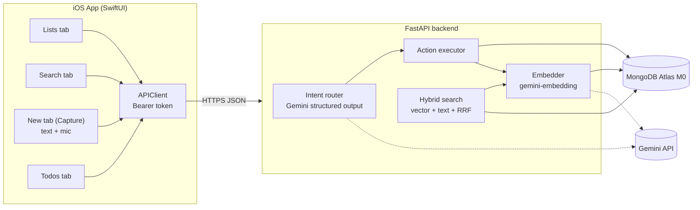
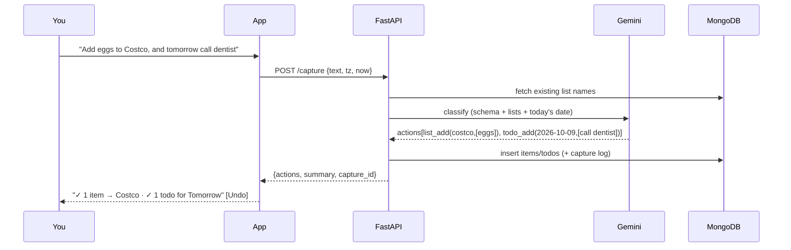

# MySpaces — AI Thought Journal for iOS (End-to-End Plan)

## Goal
Build an iOS app where you capture thoughts by **typing or speaking**. An LLM backend works out what you meant:

| You say | What happens |
|---|---|
| "What if the garage had a pegboard wall for bikes" | Saved as a **note**, embedded for semantic search |
| "Add paper towels and eggs to my Costco list" | 2 items → **Costco** list |
| "Put AirPods Max on my wish list" | 1 item → **Wish List** |
| "Tomorrow I need to call the dentist and renew registration" | Creates **tomorrow's todos** (2 items) |
| "Also add pick up dry cleaning to tomorrow" | Appends to tomorrow's todos |
| "Remind me of that idea about storing bikes" (Search tab) | Finds the pegboard note by **concept**, even with no shared keywords |

One utterance can produce **several actions** (e.g. a note plus a Costco item).

**Stack (your choices):** SwiftUI iOS app → Python FastAPI backend (local Mac first, Dockerized for Cloud Run later) → MongoDB Atlas M0 (Vector Search + Atlas Search) + Gemini API. Single user, API-token auth. Lists and todos live in the app.

---

## User Review Required

> [!IMPORTANT]
> **Gemini AI Pro ≠ Gemini API key.** The consumer Gemini AI Pro subscription does not include API billing. You need a key from **[Google AI Studio](https://aistudio.google.com/apikey)**. The free tier is plenty for one person's journal. I'll keep the model names configurable in `.env` so they're easy to swap.

> [!IMPORTANT]
> **Things only you can do (I'll walk you through them):**
> 1. Create a free Atlas M0 cluster, a DB user, and allow your IP → paste the connection string into `backend/.env`.
> 2. Create a Gemini API key → paste it into `backend/.env`.
> 3. Run `sudo xcode-select -s /Applications/Xcode.app/Contents/Developer` (needs your password). Right now the active developer directory is Command Line Tools, so `xcodebuild` won't run.
> 4. `brew install xcodegen`, which generates the `.xcodeproj` from a readable `project.yml`.

> [!WARNING]
> **Hybrid search on M0:** `$rankFusion` needs MongoDB 8.1+ on a dedicated cluster. I'll run `$vectorSearch` and `$search` as two queries and merge them in Python with Reciprocal Rank Fusion (RRF). The result is the same and it works on the free tier.

> [!NOTE]
> **Phone → Mac networking during dev:** the Simulator can reach `http://localhost:8000` directly. A physical iPhone needs your Mac's LAN IP (set in the app's Settings screen) or a tunnel. The Cloud Run deploy (Phase 6) removes this problem.

## Open Questions
1. **Default lists:** I'll seed **Costco**, **Walmart**, and **Wish List**. If you mention a list that doesn't exist ("add bananas to my Trader Joe's list"), should I **auto-create it** (my default) or ask first?
2. **Ambiguous input:** if the LLM's confidence is low (e.g. "milk"), I'll save it as a note and show a "Did you mean: add to Costco?" quick-fix chip. OK?
3. **Overdue todos:** should unfinished todos roll over to today automatically? My default is no; they show in an "Overdue" section.

---

## Architecture



### Capture flow


---

## Proposed Changes

Repo layout (monorepo):
```
MySpaces/
├── backend/          # FastAPI + Gemini + MongoDB
├── ios/              # SwiftUI app (XcodeGen project.yml)
├── README.md
└── .gitignore
```

---

### Component 1 — Backend: config & data layer

#### [NEW] backend/pyproject.toml
Dependencies: `fastapi`, `uvicorn[standard]`, `pymongo` (async API, `AsyncMongoClient`), `google-genai`, `pydantic-settings`, `python-dateutil`. Dev dependencies: `pytest`, `pytest-asyncio`, `httpx`, `mongomock-motor` or a test Atlas DB.

#### [NEW] backend/.env.example
```env
MONGODB_URI=mongodb+srv://<user>:<pw>@cluster0.xxxx.mongodb.net
MONGODB_DB=myspaces
GEMINI_API_KEY=...
GEMINI_CHAT_MODEL=gemini-2.5-flash
GEMINI_EMBED_MODEL=gemini-embedding-001
EMBED_DIM=768
API_TOKEN=<random 32+ chars>   # iOS sends as Bearer token
```

#### [NEW] backend/app/db.py — collections & indexes
| Collection | Shape |
|---|---|
| `notes` | `{_id, text, title, tags[], embedding[768], created_at, updated_at, capture_id}` |
| `lists` | `{_id, name, slug, kind: shopping\|wishlist\|custom, aliases[], created_at}` |
| `list_items` | `{_id, list_id, text, quantity?, done, created_at, capture_id}` |
| `todos` | `{_id, text, due_date: "YYYY-MM-DD", done, done_at?, created_at, capture_id}` |
| `captures` | `{_id, raw_text, actions[], created_at}` — audit log + **undo** |

On startup the app creates the normal indexes and **programmatically creates the Atlas indexes** (`create_search_index`), so there's no console clicking:
```python
VECTOR_INDEX = {"name": "notes_vector", "type": "vectorSearch", "definition": {
  "fields": [{"type": "vector", "path": "embedding", "numDimensions": 768, "similarity": "cosine"}]}}
TEXT_INDEX = {"name": "notes_text", "type": "search", "definition": {
  "mappings": {"dynamic": False, "fields": {
    "text": {"type": "string"}, "title": {"type": "string"}, "tags": {"type": "string"}}}}}
```

---

### Component 2 — Backend: AI layer

#### [NEW] backend/app/ai/schemas.py — structured output contract
```python
class Action(BaseModel):
    type: Literal["note", "list_add", "todo_add", "todo_complete", "list_item_remove"]
    # note
    note_text: str | None = None
    title: str | None = None
    tags: list[str] = []
    # list ops
    list_name: str | None = None        # normalized to an existing list when possible
    items: list[str] = []
    # todo ops
    due_date: str | None = None         # ISO date, resolved from "tomorrow", "friday", etc.
    confidence: float

class RouterResult(BaseModel):
    actions: list[Action]
```

#### [NEW] backend/app/ai/router.py — intent router
- Calls Gemini with `response_mime_type="application/json"` and `response_schema=RouterResult`.
- The system prompt includes **today's date and weekday in your timezone** (sent by the app), the **existing list names and aliases**, and few-shot examples (Costco/Walmart/wish list/tomorrow/multi-intent).
- Rules: dates are always absolute ISO; split compound sentences into multiple actions; anything idea-like or reflective → `note`; keep the user's wording for items.
- Post-processing: fuzzy-match `list_name` to existing lists (`"costco list"` → `Costco`), auto-create unknown lists (see Open Q1), and check that `due_date` falls within ±1 year.
- Fallback: if Gemini errors or times out, **always save the raw text as a note** so nothing is lost.

#### [NEW] backend/app/ai/embeddings.py
`embed(text, task_type)` uses `RETRIEVAL_DOCUMENT` for notes and `RETRIEVAL_QUERY` for searches, with `output_dimensionality=768`. Vectors are normalized.

#### [NEW] backend/app/search.py — hybrid search
```python
async def hybrid_search(q: str, k: int = 20):
    qvec = await embed(q, "RETRIEVAL_QUERY")
    vec = notes.aggregate([{"$vectorSearch": {"index": "notes_vector", "path": "embedding",
            "queryVector": qvec, "numCandidates": 200, "limit": 50}},
            {"$project": {"embedding": 0, "score": {"$meta": "vectorSearchScore"}}}])
    txt = notes.aggregate([{"$search": {"index": "notes_text", "text": {"query": q,
            "path": ["text", "title", "tags"], "fuzzy": {"maxEdits": 1}}}}, {"$limit": 50}])
    return rrf_merge(await vec.to_list(), await txt.to_list(), k=60, weights=(0.65, 0.35))[:k]
```
- **Concept search** comes from vectors; **exact phrases and names** come from text search with typo tolerance; RRF merges the two.
- Optional **"Ask" mode** (`POST /ask`): retrieve the top 8 notes, then Gemini answers "what were my ideas about X?" with citations to note IDs, which link back to the notes in the app.

---

### Component 3 — Backend: API

#### [NEW] backend/app/main.py + backend/app/routes/*.py
Every route needs `Authorization: Bearer $API_TOKEN`.

| Method | Path | Purpose |
|---|---|---|
| POST | `/capture` | `{text, timezone, client_now}` → route → execute → `{capture_id, actions, summary}` |
| POST | `/capture/{id}/undo` | Reverts every action from that capture |
| GET | `/search?q=` | Hybrid search over notes |
| POST | `/ask` | RAG answer + cited notes |
| GET/PATCH/DELETE | `/notes`, `/notes/{id}` | Browse/edit (re-embeds on edit) |
| GET/POST/DELETE | `/lists`, `/lists/{id}` | Manage lists |
| GET/POST/PATCH/DELETE | `/lists/{id}/items[/{item_id}]` | Check off / add / remove items |
| GET | `/todos?date=YYYY-MM-DD` and `/todos?range=overdue` | Daily view |
| POST/PATCH/DELETE | `/todos[/{id}]` | Manual add / toggle / delete |
| GET | `/health` | Liveness |

#### [NEW] backend/app/executor.py
Turns each `Action` into DB writes, tags everything with `capture_id` (that's what makes undo work), and builds the human summary string.

#### [NEW] backend/Dockerfile, backend/Makefile
`make dev` runs `uvicorn --reload --host 0.0.0.0`; `make test`; `make seed` creates the default lists.

---

### Component 4 — iOS app (SwiftUI, iOS 17+, `@Observable`)

#### [NEW] ios/project.yml (XcodeGen)
Targets: `MySpaces` (app) and `MySpacesTests`. Info.plist keys: `NSMicrophoneUsageDescription`, `NSSpeechRecognitionUsageDescription`, `NSAppTransportSecurity` local-networking exception (dev only).

#### [NEW] ios/MySpaces/… file structure
```
App/MySpacesApp.swift          # TabView: Lists · Search · New · Todos · Settings
Networking/APIClient.swift     # async/await, Codable, Bearer token, error mapping
Networking/Models.swift        # Note, ListModel, ListItem, Todo, CaptureResponse, Action
Storage/Keychain.swift         # stores API token + base URL
Speech/SpeechRecognizer.swift  # SFSpeechRecognizer + AVAudioEngine, on-device, live partials
Features/Capture/CaptureView.swift + CaptureViewModel.swift
Features/Search/SearchView.swift + SearchViewModel.swift     # debounced, "Ask" toggle
Features/Lists/ListsView.swift, ListDetailView.swift          # swipe to check / delete
Features/Todos/TodosView.swift                                 # Today / Tomorrow / date picker / Overdue
Features/Notes/NoteDetailView.swift                            # view/edit note
Features/Settings/SettingsView.swift                           # server URL, token, test connection
```

**Capture screen:** a large text editor and a **hold-to-talk mic button** that streams the live transcript into the editor. Tap **Send** → result cards appear ("📝 Note saved", "🛒 2 items → Costco", "✅ 2 todos for Tue Oct 9") with an **Undo** button and low-confidence "Did you mean…" chips. Recent captures show below.

**Search screen:** a search bar (debounced 300 ms) and a results list showing snippet, date, and tags. An **Ask** segment shows an AI answer with tappable cited notes.

**Todos screen:** a segmented control Today / Tomorrow / Pick date, an Overdue section, tap to toggle, and a quick-add field.

---

### Component 5 — Docs
#### [NEW] README.md
Atlas setup steps (with screenshots-as-text), Gemini key, `.env`, running the backend, generating and running the iOS app, and phone-on-LAN instructions.

---

## Phased Execution

| Phase | Deliverable | Done when |
|---|---|---|
| 1 | Backend skeleton, config, Mongo connection, index bootstrap, `/health` | `curl /health` → ok against your Atlas |
| 2 | Intent router + executor + `/capture` + undo | Golden-set tests pass (see below) |
| 3 | Embeddings + hybrid search + `/ask` | Concept query finds the target note |
| 4 | Lists/Todos/Notes CRUD | pytest green |
| 5 | iOS app: all tabs, speech, settings | `xcodebuild build test` green; manual walk-through in Simulator |
| 6 | Dockerfile + Cloud Run deploy notes | `docker build` succeeds (deploy when you're ready) |

---

## Verification Plan

### Automated Tests
```bash
# Backend unit tests (Gemini mocked; DB = isolated test database on your Atlas cluster)
cd backend && make test            # pytest -q

# Live intent golden set (~25 utterances → expected actions), hits real Gemini
cd backend && pytest -m live tests/test_router_golden.py

# iOS
cd ios && xcodegen && xcodebuild -scheme MySpaces \
  -destination 'platform=iOS Simulator,name=iPhone 17' build test
```
Golden-set examples:
- "add eggs and paper towels to costco" → `list_add(Costco, [eggs, paper towels])`
- "wishlist: kindle scribe" → `list_add(Wish List, [kindle scribe])`
- "tomorrow: gym, email Raj" (today = Thu Oct 8) → `todo_add(2026-10-09, [gym, email Raj])`
- "idea: app that tracks plant watering by photo" → `note`
- "grab milk at walmart and also I had a thought about a bike rack" → `list_add` + `note`

Search tests: seed 10 notes, then check that a paraphrased query ("storing bicycles in the garage") returns the pegboard note in the top 3, and an exact rare phrase ranks first.

### Manual Verification
1. In the Simulator, dictate "Add bananas to my Costco list and tomorrow I need to call mom" → see 2 result cards → check the Lists and Todos tabs.
2. Tap **Undo** → both disappear.
3. Capture 5 varied ideas, then search by concept and by exact phrase.
4. Switch "Ask" on: "what ideas have I had about the garage?" → answer cites notes.
